# PRISM — Project Resources Integration & Status Management

> Repository: `ticksys`

PRISM adalah aplikasi operasional internal untuk divisi **Equipment & Technology**. Isinya helpdesk
ticketing untuk kerusakan device di lapangan, monitoring project, inventaris aset, manpower, laporan, dan
register penomoran surat.

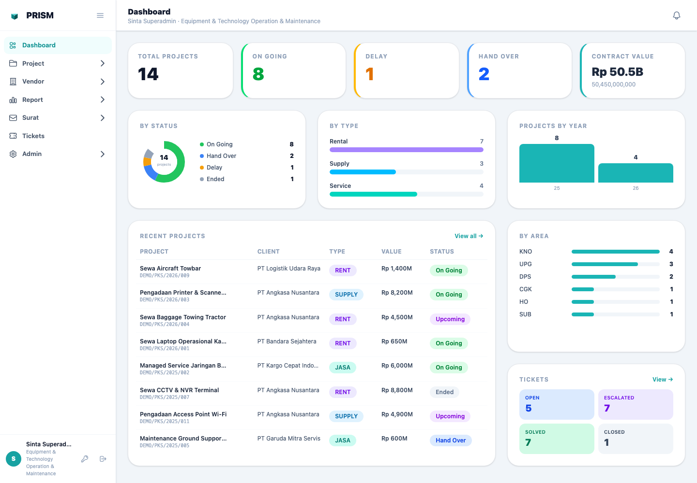

---

## Daftar isi

- [Fitur](#fitur)
- [Tech stack](#tech-stack)
- [Role & hak akses](#role--hak-akses)
- [Instalasi lokal](#instalasi-lokal)
- [Menjalankan dengan Docker](#menjalankan-dengan-docker)
- [Testing & code style](#testing--code-style)
- [Struktur proyek](#struktur-proyek)
- [Catatan arsitektur](#catatan-arsitektur)
- [Dokumentasi lain](#dokumentasi-lain)

---

## Fitur

> Semua screenshot diambil dari database demo berisi data fiktif.

### Dashboard

**Dashboard manajemen** (superadmin, admin, siteadmin, vip) berisi:
- KPI project: total, on going, delay, hand over, dan nilai kontrak.
- Distribusi project per status, tipe, tahun, dan area.
- Daftar project terbaru.
- Ringkasan tiket.

**Dashboard teknisi** (role `user`) hanya menampilkan project tempat teknisi ditugaskan:
- Kesehatan device dan kondisi aset.
- Tiket berjalan dan statistik tiket 8 minggu terakhir.
- Device berkondisi *Bad*.

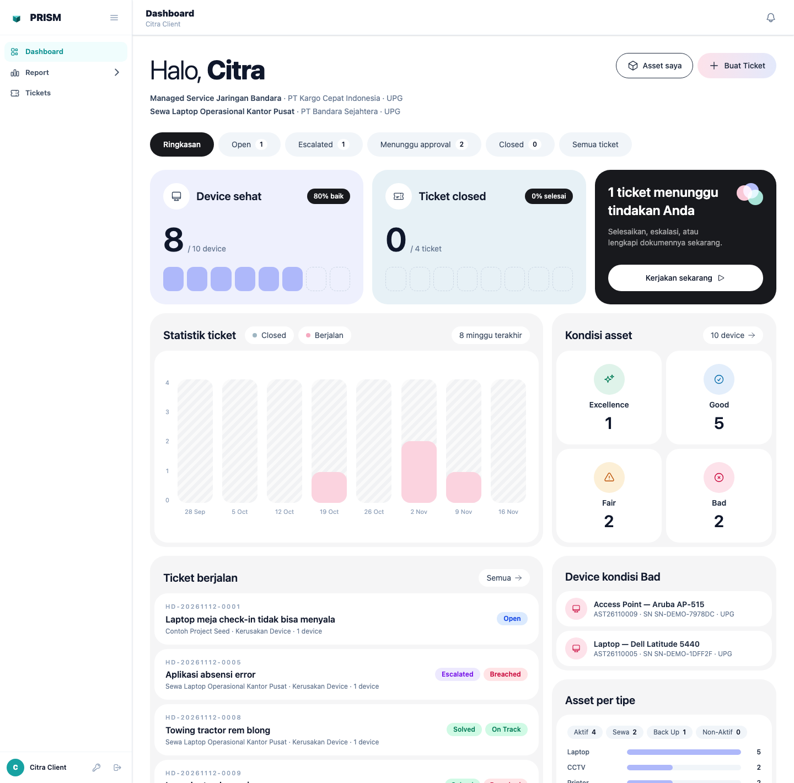

### Helpdesk ticketing — alur kerusakan lapangan

Tiket melewati alur `open → escalated → solved → closed`:

1. **Open**: teknisi membuat tiket beserta kronologi, lalu memilih device dari project-nya. Untuk jenis
   *Kerusakan Device* dan *Accident*, device wajib dipilih; untuk *Masalah Sistem*, device opsional.
2. **Escalated**: bila perlu, tiket dinaikkan ke tim pusat dengan BA serah terima. Setelah selesai,
   tim divisi project mengembalikannya ke teknisi.
3. **Solved**: teknisi menandai tiket selesai.
4. **Closed**: atasan langsung menyetujui (approve) atau menolak.

Selama tiket belum *closed*, kondisi device otomatis menjadi **Bad**. Fitur pendukung:
- SLA per tiket. Scheduler mengirim notifikasi bila target terlewati (`app:run-helpdesk-automation`,
  setiap 5 menit).
- Diskusi dengan @mention.
- Lampiran dokumen.
- Riwayat aktivitas.
- Notifikasi in-app dan email.
- Tombol submit terkunci setelah diklik, sehingga double-click tidak berakhir di halaman 403.
- Superadmin bisa menghapus tiket secara permanen dengan mengetik ulang nomor tiket. Kondisi device
  dikembalikan, lampiran ikut dihapus, dan penghapusan tercatat di `system_logs`.

| Daftar tiket | Buat tiket |
|---|---|
| 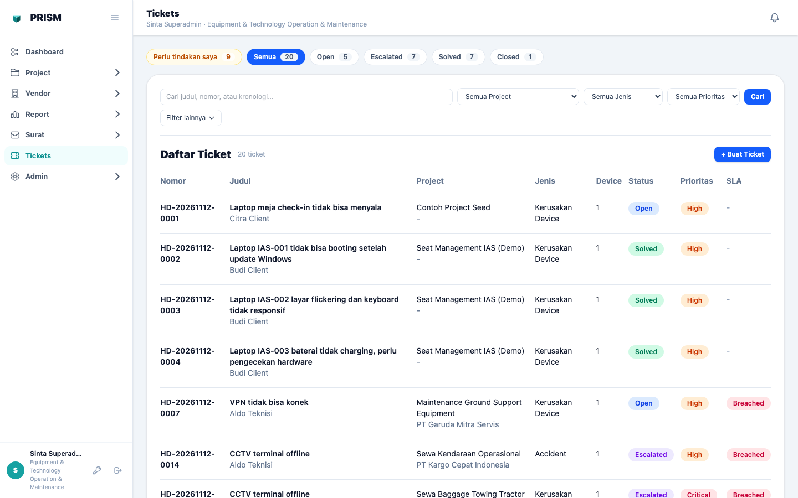 | 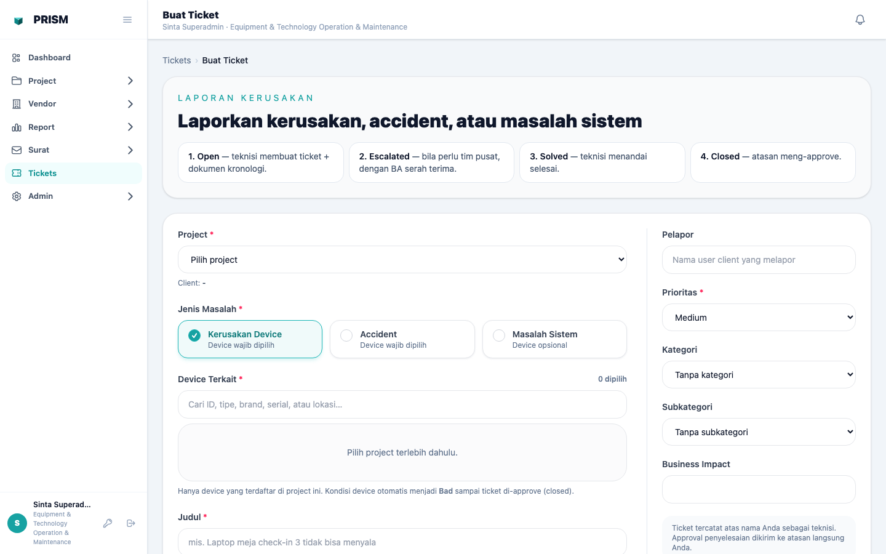 |

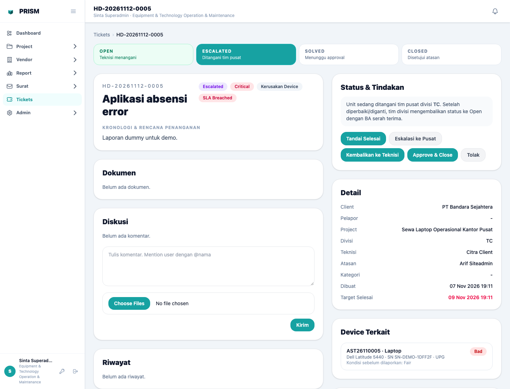

### Project monitoring

`pjct_main` adalah data induk project.
- **Divisi**: `TC` / `EQ` / `TCC` / `EQC`
- **Status**: `UPC` / `OG` / `HVR` / `DLY` / `END`
- **Tipe**: `RENT` / `SUPPLY` / `JASA`

Fitur di halaman ini:
- Filter dan pencarian.
- Arsip (soft delete).
- Dokumen legal per project (Kontrak, RKST, RAB, BAST, SOP) yang dibuka langsung di browser.
- Bulk import project dari Excel.

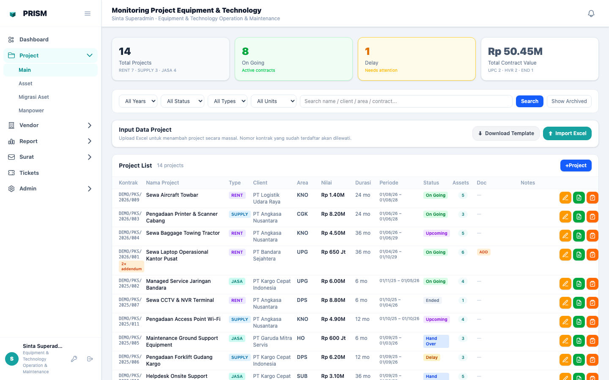

**Addendum kontrak** dicatat sebagai riwayat project:
- Setiap addendum menyimpan nomor, tanggal, satu atau lebih dari 10 alasan baku (masing-masing dengan
  catatan), PDF bertanda tangan, dan snapshot nilai sebelum/sesudah.
- Perubahan nilai, tanggal akhir, dan client langsung diterapkan ke project.
- Yang bisa mencatat: superadmin dan admin E&T Commercial.

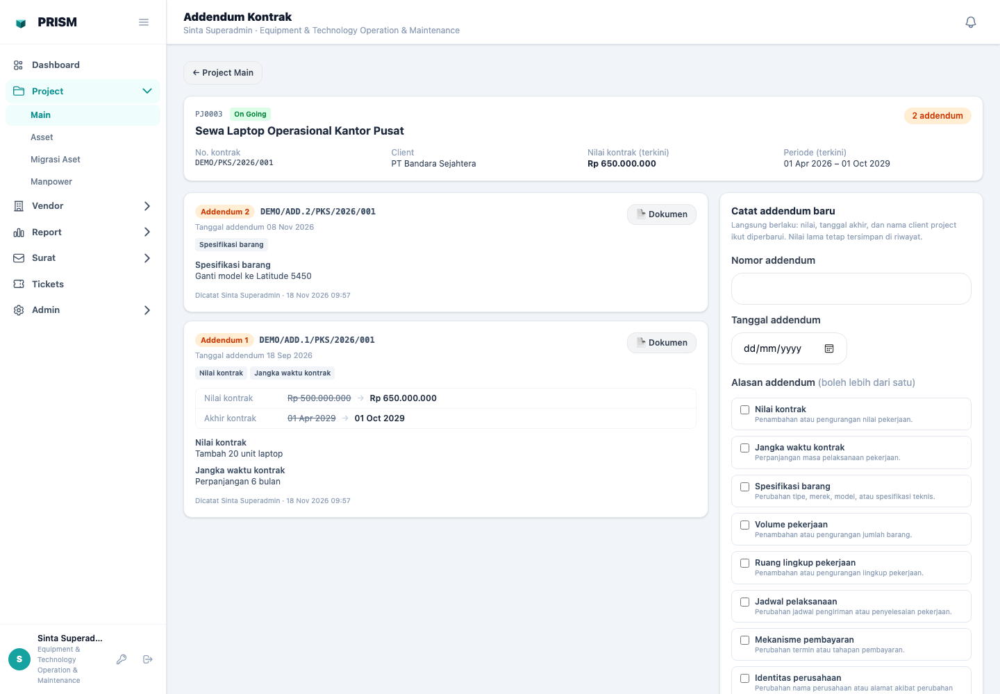

### Aset & manpower

- **Asset**: inventaris equipment per project, mencakup kondisi (*Excellence / Good / Fair / Bad*),
  status (*Aktif, Sewa, Back Up, Pinjam, Non-Aktif*), lokasi, dan pengguna.
- **Manpower**: staf yang ditugaskan per project, dengan NIK sebagai kunci. Data ini juga menentukan
  project mana yang terlihat oleh teknisi.
- Keduanya mendukung **bulk import Excel dengan pratinjau**: upload, pratinjau baris
  `new` / `skip` / `error`, lalu konfirmasi. Import hanya menambah baris baru; baris duplikat dilewati
  dan tidak pernah di-update.

| Asset | Manpower |
|---|---|
| 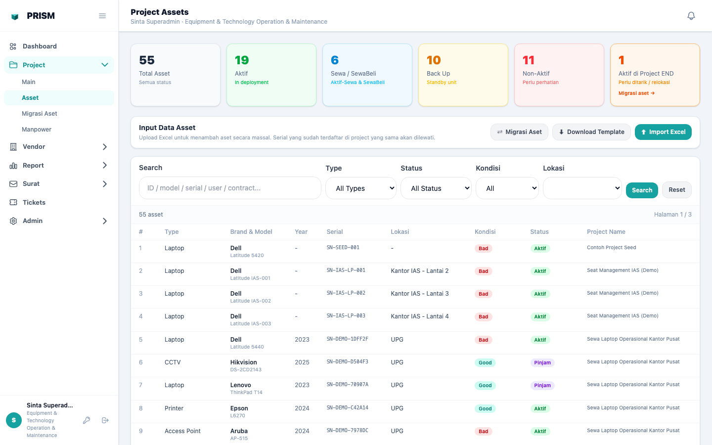 | 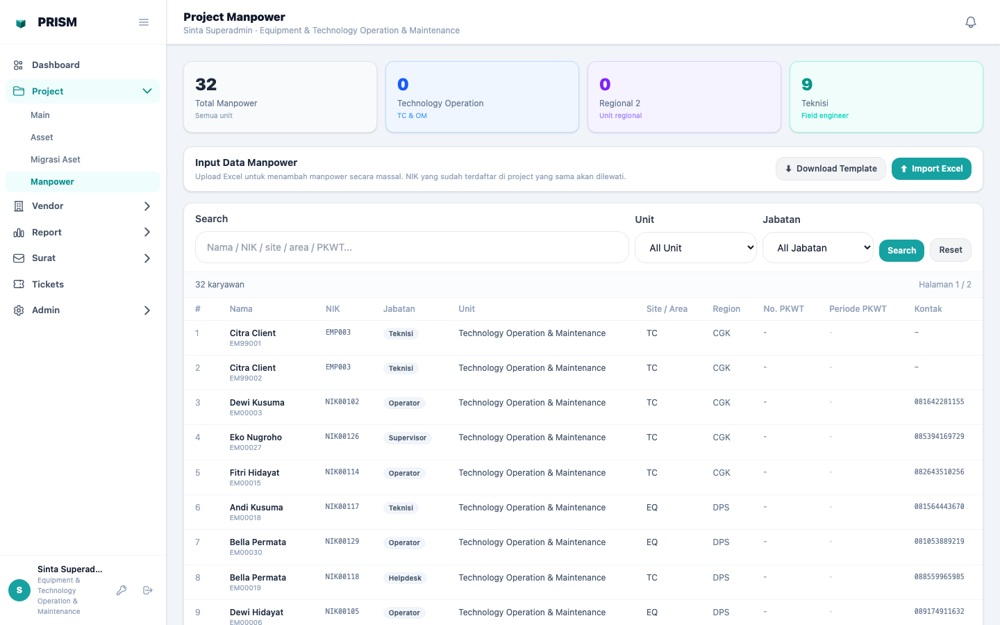 |

**Migrasi aset** (Project → Migrasi Aset) memindahkan equipment dari project yang kontraknya habis ke
project yang masih berjalan:
- Status bisa di-reset dan data pengguna/lokasi dikosongkan.
- Aset yang masih terikat tiket aktif memblokir seluruh batch (semua-atau-tidak sama sekali).
- Setiap batch tersimpan beserta snapshot data lama.
- Hak aksesnya sama dengan import aset.

| Migrasi aset | Detail migrasi |
|---|---|
| 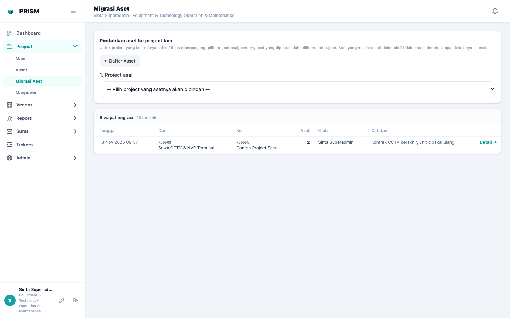 | 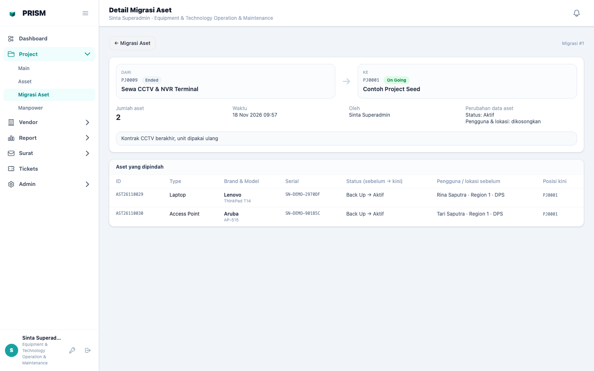 |

### Report

- **Report → Assets**: tarikan seluruh kolom `ast_main`.
  - Filter gabungan dan sorting per kolom.
  - Export `.xlsx` dua sheet: data dan ringkasan.
- **Report → Projects**: pola yang sama untuk `pjct_main`.
  - Data dibatasi per divisi.
  - Filter *Kelengkapan* menandai sel kosong dengan warna kuning, di layar maupun di Excel.
- **Reports & Analytics** (helpdesk):
  - Total tiket, rata-rata waktu sampai *solved*, dan SLA breach rate.
  - Tiket per jenis masalah.
  - Export CSV.

| Report Assets | Report Projects |
|---|---|
| 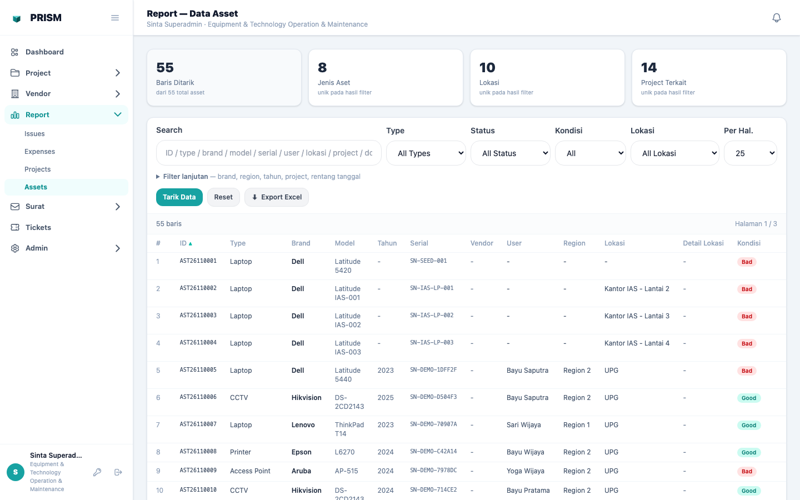 | 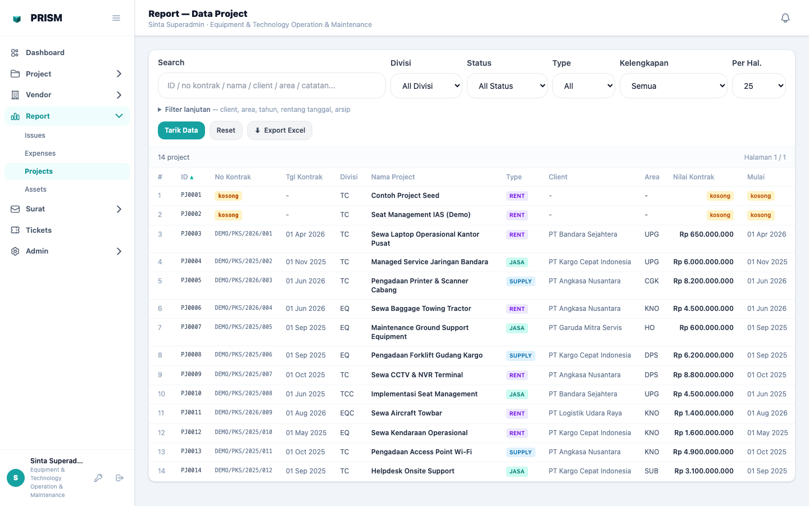 |

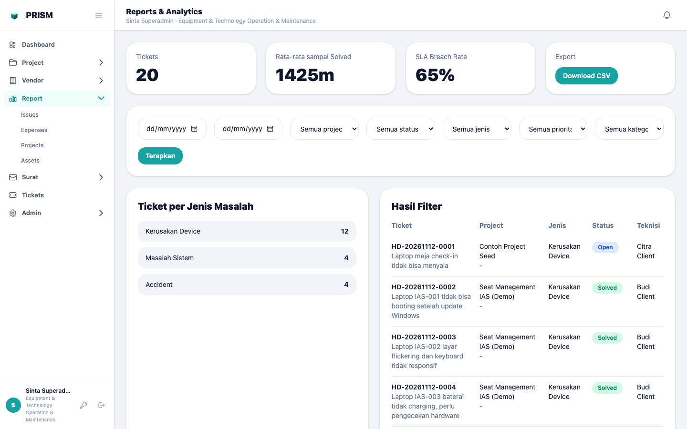

### Surat — register penomoran surat

Register nomor surat menggantikan register Excel. Format nomornya
`IASS/<unit>/<kode>/<bulan romawi>/<tahun>/<urut>`.
- Mendukung nomor turunan (`001.1`, `001.2`, ...).
- Nomor bisa dibatalkan dengan alasan.
- Lampiran file dan tautan ke project.
- Export Excel.
- Master **Jenis Surat** untuk mengelola kode dan unit.
- Register lama diimpor dengan `php artisan letters:import`.

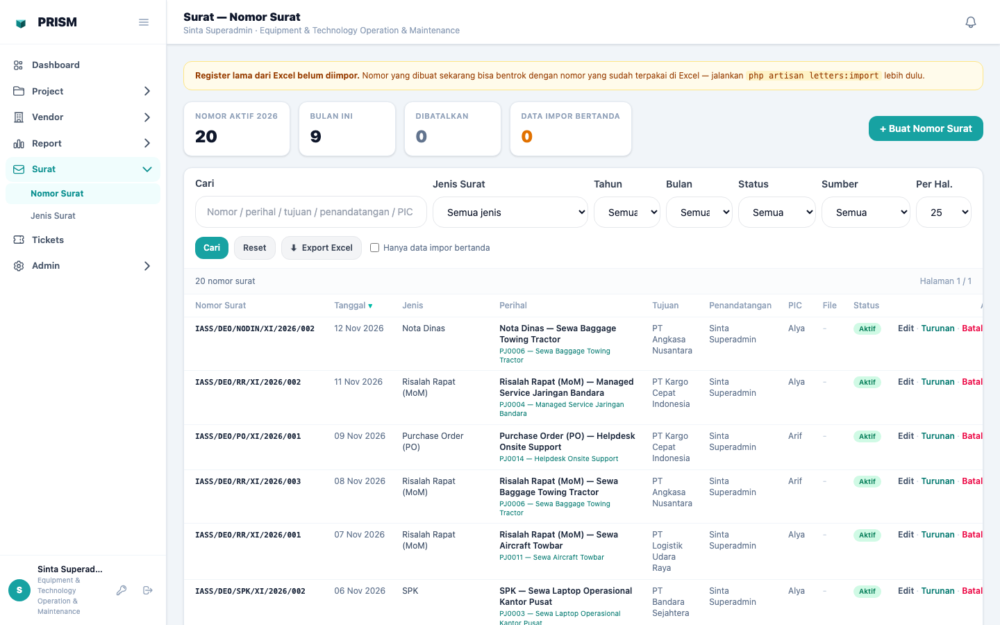

### Akun: registrasi & ganti password

- **Registrasi mandiri** (`/register`): karyawan yang NIK-nya terdaftar di data manpower bisa membuat
  akun sendiri, satu kali per NIK. Akunnya otomatis menjadi teknisi untuk project penugasan NIK tersebut.
- **Ganti password** (ikon kunci di footer sidebar): tersedia untuk semua role. Wajib memasukkan password
  lama; password baru minimal 8 karakter dan berisi huruf serta angka. Setelah diganti, sesi di
  perangkat lain langsung diputus.

| Registrasi | Ganti password |
|---|---|
| 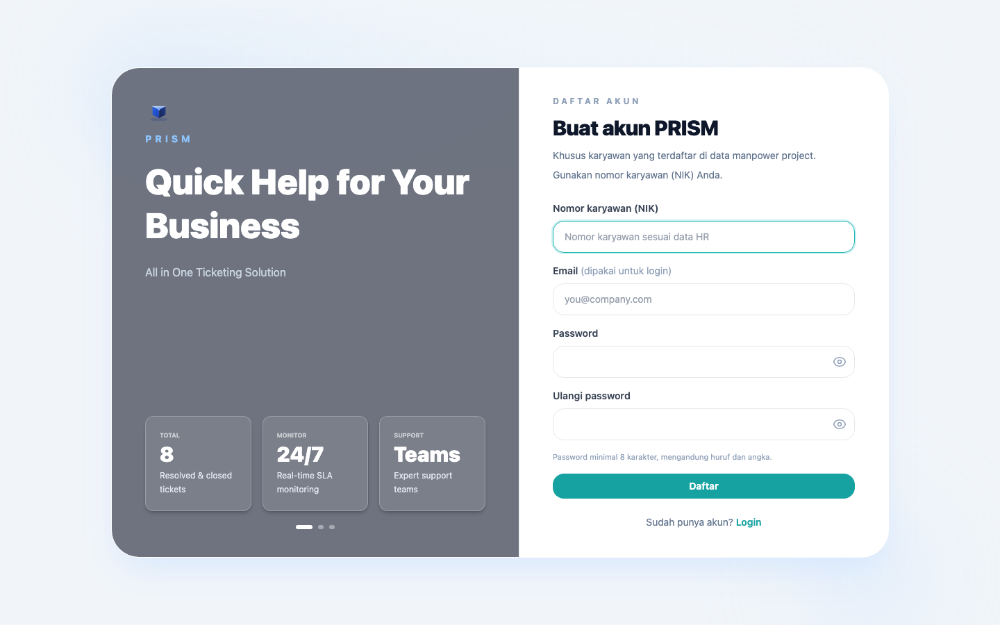 | 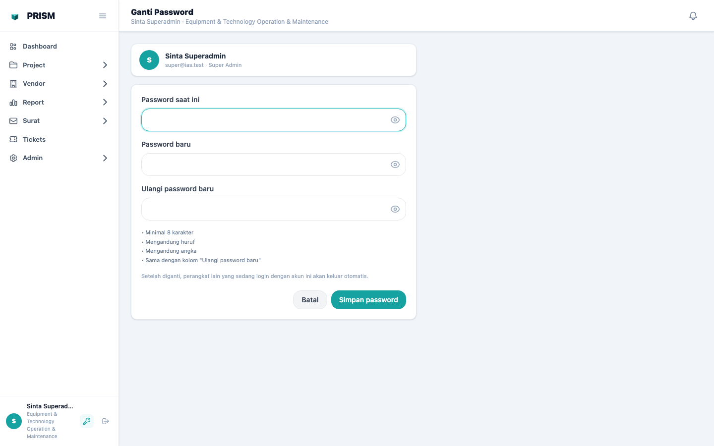 |

### Admin — IAM Role

Manajemen user: buat, ubah, dan hapus akun, termasuk role, unit/divisi, atasan (`user_parid`), status
aktif, dan reset password. Menu ini hanya untuk superadmin.

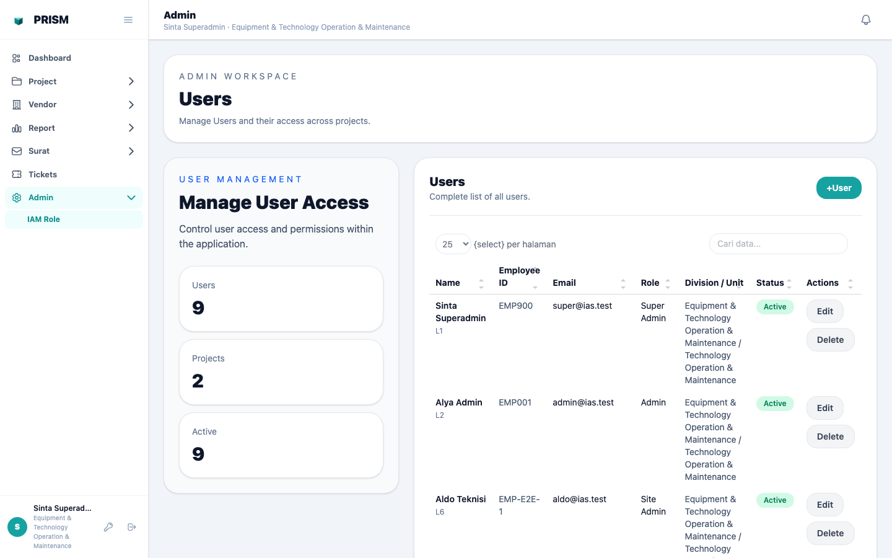

### Dalam pengembangan

Halaman **Vendor**, **Vendor Contracts**, **Report → Issues**, dan **Report → Expenses** sudah ada di menu,
tetapi masih berupa placeholder *coming soon*.

---

## Tech stack

| Lapisan | Teknologi |
|---|---|
| Backend | PHP 8.3+, Laravel 13 |
| Frontend | Blade, Tailwind CSS v4, vanilla JS, Chart.js, simple-datatables (tanpa SPA framework) |
| Build | Vite |
| Database | MySQL 8 / MariaDB. Test memakai SQLite in-memory |
| Excel | PhpSpreadsheet |
| Test | Pest 4 |
| Deploy | Docker + Caddy (`docker-compose.prod.yml`) |

---

## Role & hak akses

Tidak memakai package roles/permissions. Role disimpan di `users.user_role` dan dicek dengan middleware
`role:` per grup route.

| Role | Akses |
|---|---|
| `superadmin` | Semua menu dan semua divisi, termasuk Admin (manajemen user) dan import project/manpower |
| `vip` | Lihat semua divisi (read-oriented) |
| `admin` | Menu operasional, dibatasi divisi unit-nya. Admin divisi E&T O&M boleh import aset |
| `siteadmin` | Menu operasional, dibatasi divisi |
| `user` | **Teknisi lapangan**: dashboard teknisi, daftar aset (lewat Report → Assets), dan Tickets, hanya untuk project penugasannya (dicocokkan lewat NIK di `pjct_emp`) |
| `fin` | **Finance** (daftar putih): hanya Dashboard, Project → Asset, dan Report → Assets |
| `qhsse` | **QHSSE**, hanya-lihat (daftar putih): Dashboard, Project → Main dan dokumennya, Project → Asset, Tickets. Mencakup semua divisi |

Data dibatasi di dua lapis:
- **Route**: middleware `EnsureRole`.
- **Data**: `User::allowedDivCodes()`, yaitu pemetaan unit ke kode divisi ditambah divisi bawahan lewat
  `user_parid`.

Pembatasan data **bukan** global scope. Controller yang menyentuh data project harus menerapkannya
secara manual.

---

## Instalasi lokal

**Prasyarat**: PHP 8.3+ (ekstensi `pdo_mysql`, `mbstring`, `bcmath`, `gd`, `zip`, `intl`), Composer, Node.js 20+, dan MySQL 8 / MariaDB.

```bash
git clone git@github.com:riandakarizal/ticksys.git
cd ticksys

composer install
npm install
cp .env.example .env
php artisan key:generate
```

Atur koneksi database di `.env` (`DB_DATABASE`, `DB_USERNAME`, `DB_PASSWORD`) dan SMTP bila perlu. Lalu:

```bash
php artisan migrate --seed                 # skema + data contoh
php artisan db:seed --class=E2EDemoSeeder  # opsional: project & tiket demo
php artisan storage:link
```

> **Penting:** seeder menyimpan `user_pass` sebagai teks biasa, sedangkan login memakai bcrypt. Setelah
> seeding, hash ulang password akun contoh:
>
> ```bash
> php artisan tinker --execute="App\Models\User::query()->each(fn (\$u) => \$u->forceFill(['user_pass' => bcrypt('password')])->save());"
> ```

Jalankan aplikasi:

```bash
composer run dev     # server + queue worker + Vite sekaligus → http://localhost:8000
```

Kalau ingin dijalankan terpisah: `php artisan serve`, `php artisan queue:listen`, dan `npm run dev`.
Untuk production, build aset dengan `npm run build`.

Scheduler (notifikasi SLA) dijalankan lewat cron:

```cron
* * * * * cd /path/to/ticksys && php artisan schedule:run >> /dev/null 2>&1
```

**Akun contoh** (password `password` setelah di-hash):

| Email | Role |
|---|---|
| `admin@ias.test` | admin |
| `siteadmin@ias.test` | siteadmin |
| `client@ias.test` | user (teknisi) |

Akun `superadmin` tidak dibuat oleh seeder. Buat satu akun lewat tinker, atau ubah `user_role` akun
admin. Teknisi yang NIK-nya ada di data manpower bisa membuat akun sendiri di `/register`.

---

## Menjalankan dengan Docker

```bash
docker compose up --build -d     # app di http://localhost:8080 + MySQL 8
```

- Saat volume database masih kosong, MySQL otomatis mengimpor `docker/db-init/01-prism.sql`.
- Folder `docfile/` (dokumen project) **tidak** ikut di Git maupun di dump database. Salin folder ini
  terpisah.
- Untuk production dengan Caddy, pakai `docker-compose.prod.yml`.

Panduan lengkap memindahkan aplikasi ke mesin lain ada di
[docs/DOCKER-MIGRATION.md](docs/DOCKER-MIGRATION.md).

---

## Testing & code style

```bash
composer test                                   # config:clear + Pest
php artisan test --filter=TicketWorkflow        # filter by nama
vendor/bin/pest tests/Feature/Letters           # satu folder/file
vendor/bin/pint                                 # format kode (Laravel Pint)
```

Test berjalan di SQLite in-memory, sedangkan dev/prod memakai MySQL. Karena itu, hindari SQL khusus
MySQL (fungsi JSON, aritmetika tanggal, dll.) di kode yang ikut dites.

---

## Struktur proyek

```
app/
├── Http/Controllers/       # Ticket, Monitoring, Asset(+Migration), ProjectAddendum, Manpower, Report,
│                           # Letter, Register, AccountPassword, Admin/UserController
├── Http/Middleware/        # EnsureRole
├── Models/                 # User, Ticket, PjctMain, AstMain, PjctEmp, Letter, ...
├── Policies/               # TicketPolicy
└── Support/                # TicketManager, Helpdesk, *ImportService, *ExportService, LetterNumberService,
                            # AssetMigrationService, ProjectAddendumService
database/
├── migrations/
└── seeders/                # DatabaseSeeder, E2EDemoSeeder
resources/views/            # Blade: tickets/, letters/, monitoring/, project/, report/, admin/
routes/web.php              # semua route + middleware role
tests/Feature/              # Pest: Tickets, Letters, Monitoring, Project, Auth
docs/                       # dokumentasi database, sistem, docker, keamanan
docfile/                    # dokumen project per PJxxxx (tidak di-track Git)
```

---

## Catatan arsitektur

- **Primary key berbentuk string.** Beberapa tabel membuat ID sendiri di hook `creating`:
  - `PjctMain` → `PJ0001`
  - `AstMain` → `AST2611xxxx`
  - `PjctEmp` → `EMxxxxx`
  - `users.id` → `USR-NNN`

  Insert di luar Eloquent (raw insert, import) harus mengikuti format ini. Bulk import memesan blok ID
  di awal lewat `nextIds()`.
- **Login memakai kolom `user_pass`**, bukan `password`. Lihat `User::getAuthPassword()`.
- **Dokumen project** disimpan di `docfile/PJxxxx/`, diindeks tabel `pjct_doc`, dan dikirim lewat
  `PjctDocController`. Akses dokumen mengikuti pembatasan divisi.
- **Export besar** membaca baris dengan `cursor()`. Semua query agregat harus selesai sebelum iterasi
  dimulai.

---

## Dokumentasi lain

| Dokumen | Isi |
|---|---|
| [docs/PRISM-DATABASE.md](docs/PRISM-DATABASE.md) | Referensi skema per kolom dan tabel unit → divisi |
| [docs/PRISM-SYSTEM-DOCUMENT.md](docs/PRISM-SYSTEM-DOCUMENT.md) | Dokumen sistem |
| [docs/DOCKER-MIGRATION.md](docs/DOCKER-MIGRATION.md) | Migrasi ke mesin lain via Docker |
| [docs/CLOUD-MIGRATION.md](docs/CLOUD-MIGRATION.md) | Rencana migrasi ke cloud |
| [docs/NIST-CSF2.md](docs/NIST-CSF2.md), [docs/RISK-REGISTER.md](docs/RISK-REGISTER.md), [docs/SBOM.md](docs/SBOM.md) | Keamanan, risiko, dan SBOM |
| [CLAUDE.md](CLAUDE.md) | Panduan kerja untuk AI assistant |

> `docs/PRISM-DATABASE.md` dan `docs/PRISM-REDESIGN.md` masih menyebut role lama
> (`supervisor`/`agent`/`client`). Yang berlaku adalah kode (`User` model dan middleware di
> `routes/web.php`).

---

## Lisensi

[Apache License 2.0](LICENSE)
